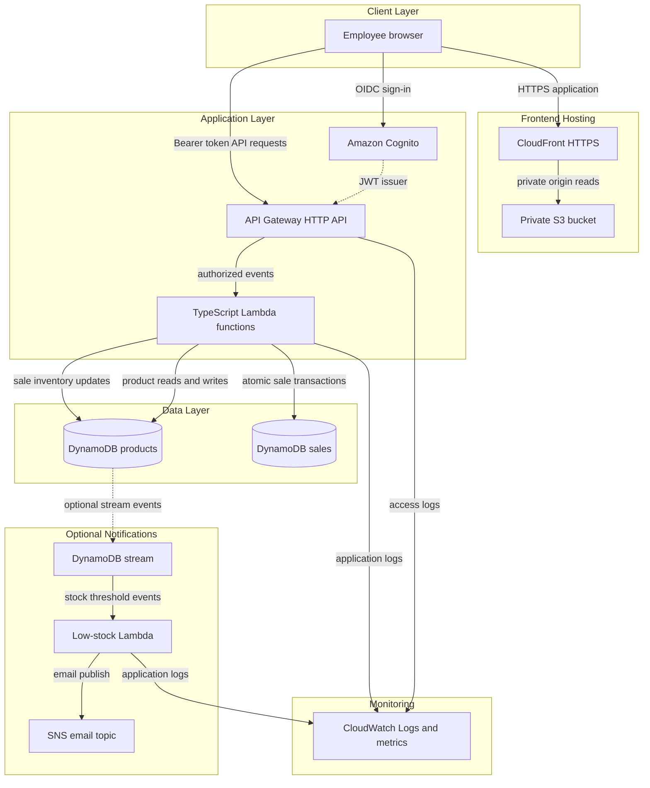
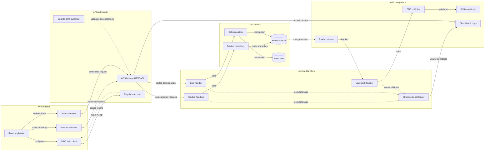

# Architecture Diagram

The application is a browser-based inventory dashboard backed by an authenticated AWS serverless API. Static assets are served from a private S3 bucket through CloudFront; product and sales data are stored in DynamoDB.

## Application Architecture

<!-- prettier-ignore-start -->
<!-- mermaid-checked: no \n, no em-dash/en-dash, no {} in labels, subgraphs are id["label"], arrows are -->|"label"|, all subgraphs closed by end, ids unique -->

<!-- prettier-ignore-end -->

### Technology Stack Summary

| Layer            | Technology                      | Version               | Purpose                                       |
| ---------------- | ------------------------------- | --------------------- | --------------------------------------------- |
| Frontend         | React                           | `^19.1.0`             | Inventory dashboard and employee workflows    |
| Frontend         | TypeScript                      | `^5.8.3`              | Typed browser application                     |
| Frontend         | Vite                            | `^6.3.5`              | Local development and static production build |
| Frontend         | Chart.js                        | `^4.6.1`              | Category inventory chart                      |
| Authentication   | Amazon Cognito                  | AWS managed           | Employee registration and OIDC login          |
| Edge and hosting | CloudFront and Amazon S3        | AWS managed           | HTTPS delivery of private static assets       |
| API              | API Gateway HTTP API            | AWS managed           | Cognito-authorized JSON routes                |
| Compute          | AWS Lambda                      | Node.js `22.x`, ARM64 | TypeScript backend handlers                   |
| Data             | Amazon DynamoDB                 | AWS managed           | Product inventory and sales records           |
| Notifications    | DynamoDB Streams and Amazon SNS | AWS managed           | Optional event-driven email alerts            |
| Observability    | Amazon CloudWatch               | AWS managed           | Structured application and API access logs    |

### Data Storage & External Services

DynamoDB stores products and sales in separate provisioned-capacity tables. A sale uses one DynamoDB transaction to decrement inventory and persist its sale record. When an email recipient is configured, a product-table stream invokes a notifier Lambda, which publishes threshold-crossing alerts to SNS. Cognito issues employee tokens for the API Gateway JWT authorizer. CloudFront reads frontend objects from the private S3 bucket using Origin Access Control.

### Key Architectural Decisions

- The public browser uses the Cognito authorization-code flow with PKCE; API routes require a Cognito access token.
- Route-specific Lambda functions use repository abstractions and narrowly scoped table permissions. Sales use an atomic transaction to prevent negative inventory.
- Low-stock alerts are optional and event-driven. The stream, worker, topic, and email subscription are omitted when no email address is configured.

## Component Relationships

<!-- prettier-ignore-start -->
<!-- mermaid-checked: no \n, no em-dash/en-dash, no {} in labels, subgraphs are id["label"], arrows are -->|"label"|, all subgraphs closed by end, ids unique -->

<!-- prettier-ignore-end -->

### Component Inventory

| Component               | Layer         | Type                  | Responsibility                                               |
| ----------------------- | ------------- | --------------------- | ------------------------------------------------------------ |
| React application       | Presentation  | SPA                   | Dashboard, product forms, analytics, and sales UI            |
| OIDC auth client        | Presentation  | Authentication client | PKCE login, logout, and access-token handling                |
| Product API client      | Presentation  | API client            | Authenticated product requests and response validation       |
| Sales API client        | Presentation  | API client            | Authenticated sale creation and response validation          |
| API Gateway HTTP API    | API           | Gateway               | CORS, route dispatch, and access logs                        |
| Cognito JWT authorizer  | API           | Authorizer            | Validates access tokens on protected API routes              |
| Product handlers        | Application   | Lambda handlers       | Product CRUD validation and responses                        |
| Sale handler            | Application   | Lambda handler        | Validates and processes inventory sales                      |
| Low-stock handler       | Application   | Stream handler        | Detects threshold transitions and reports retryable failures |
| Product repository      | Data access   | Repository            | Reads and writes product items in DynamoDB                   |
| Sale repository         | Data access   | Repository            | Applies atomic inventory and sale transactions               |
| Structured error logger | Cross-cutting | Logging utility       | Emits safe JSON error context for CloudWatch                 |
| SNS publisher           | Integration   | Notification adapter  | Publishes low-stock email messages to the configured topic   |
